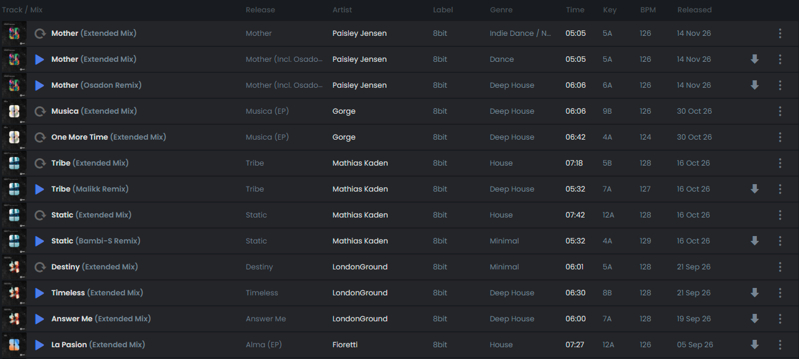
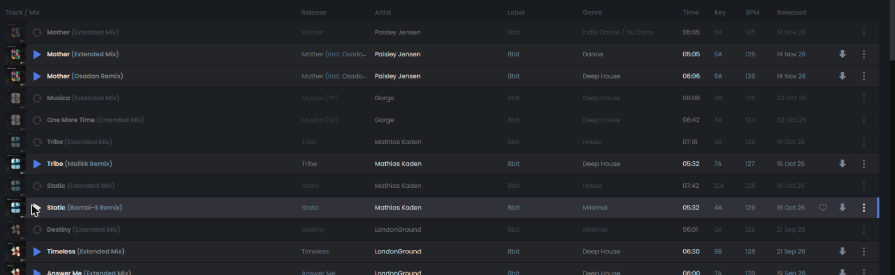
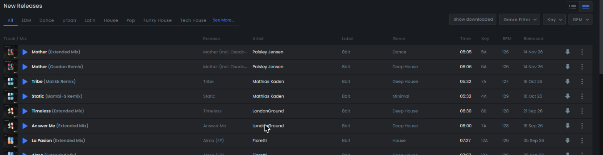
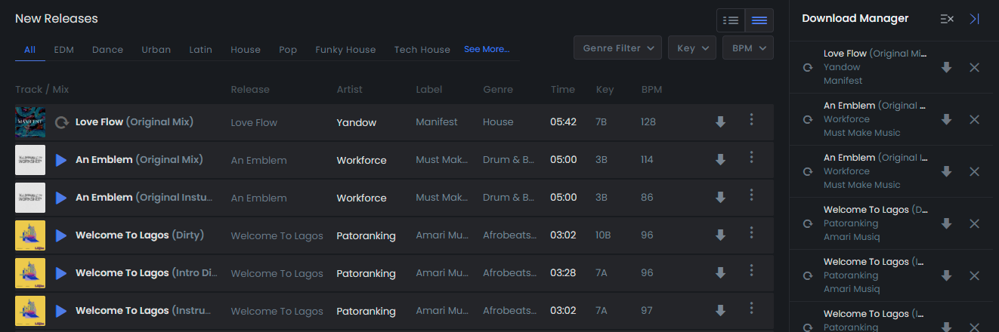
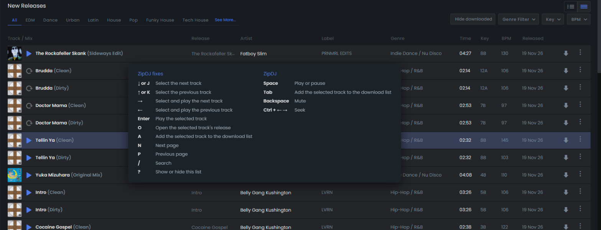
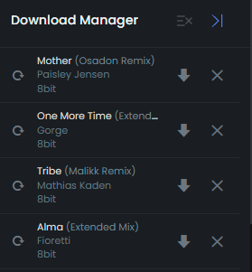
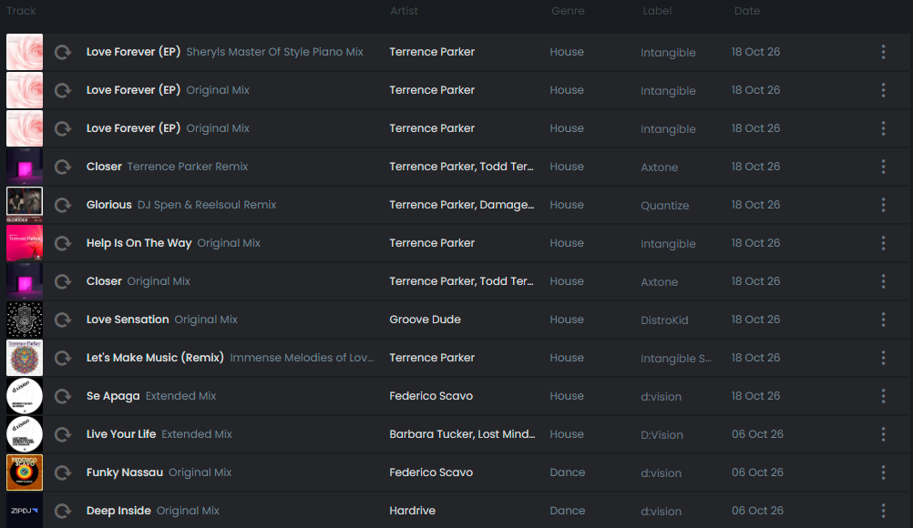

# ZipDJ fixes

A userscript for members of [ZipDJ](https://www.zipdj.com), the DJ record pool. It fixes annoyances in ZipDJ's member web app, in seven places:

- [Track lists](#track-lists): title and mix apart from the release
- [Downloaded tracks](#downloaded-tracks): dimmed or hidden in track lists
- [Roomier look](#roomier-look): taller rows, larger text, wider Label and Genre columns
- [Keyboard shortcuts](#keyboard-shortcuts): keys for track lists, and a visible selection
- [Download manager](#download-manager): links to release, artist and label
- [Download history](#download-history): a Label column and real links
- [Search box](#search-box): keeps the space you just typed

The script sends no requests of its own. It reads titles, releases and labels from data ZipDJ's pages already load. It changes only how pages look and behave in your own browser.

## What it fixes

### Track lists

ZipDJ shows a track as its release's name followed by the mix, so an EP track reads "Musica (EP) One More Time (Extended Mix)". The script shows the title with its mix in brackets, **One More Time (Extended Mix)**, and adds a Release column. A click on a release opens it. For a single, a suffix such as "(Incl. Osadon Remix)" is left out of the title.

### Downloaded tracks

Track lists dim the tracks you have already downloaded, so new ones stand out when you go through a label or an artist. Hovering a row shows it in full again. ZipDJ's own sign is easy to miss: it only leaves out the download arrow. The replay icon in place of the play icon means you have played the track, not downloaded it. The download history isn't dimmed, since every track there is downloaded.

A track you download now is dimmed the next time its list loads.

To leave downloaded tracks out altogether, click **Hide downloaded** next to Genre Filter. The button then reads **Show downloaded** and brings them back. Your browser remembers the choice for every list. A page then shows fewer than its usual 50 tracks, since ZipDJ still counts the hidden ones.

### Roomier look

Track lists and the download history get taller rows (48 instead of 40 pixels) and slightly larger text. The Label and Genre columns get a larger share of the width, so most labels and genres fit. While the download manager is open, track lists hide the Released column to leave the other columns more room. The download manager's entries get larger text and more space between lines. ZipDJ's colours and fonts stay as they are.

### Keyboard shortcuts

ZipDJ has keyboard shortcuts of its own, listed behind the keyboard icon in its player. Its selected track was hard to see, though. The script tints the selected row blue, and a click on a row selects it. It adds these keys:

| Key | What it does |
|---|---|
| J / K | Select the next / previous track |
| O | Open the selected track's release |
| A | Add the selected track to the download list, as its arrow button does. No download is spent until you download from the download manager. |
| N / P | Next / previous page |
| / | Jump to the search box |
| ? | Show or hide a list of these keys and ZipDJ's own |

ZipDJ's own keys keep working: ↑ and ↓ select, ← and → select and play, Enter plays the selected track, Space plays or pauses. Both sets act on the same selected row. J and K skip tracks hidden by **Hide downloaded**. The script's keys do nothing while you type in the search box.

On a release's own page, J and K select a track, but ZipDJ's own keys don't work there, so Enter does not play it.

### Download manager

Each entry links its release, each of its artists and its label, which is added as a third line. For an EP track, the entry shows the track's own title when the track has appeared in a list since the page was loaded. Otherwise it shows the release's name, as ZipDJ does.

### Download history

The history gets a Label column. A click on a label lists all of that label's tracks. ZipDJ shows the label on each track page, but not in the history.

Track titles become real links. Middle-click or Ctrl+click opens the release in a new tab, so the history keeps its place and doesn't reload.

### Search box

On the search results page, a space typed right after a letter no longer disappears.

## Status

Version 1.5.0, 18 November 2026. It was tested by injection in Chrome. Version 1.0.0, the first public release, was also tested with Violentmonkey in Firefox.

## Install

1. Install a userscript manager: [Violentmonkey](https://violentmonkey.github.io/) (recommended) or Tampermonkey. In Chrome, also turn on **Allow User Scripts** in the extension's details.
2. Install the script from [Greasy Fork](https://greasyfork.org/scripts/606173-zipdj-fixes) with its install button. Or open [zipdj-fixes.user.js](https://github.com/thomaswening/zipdj-fixes/raw/main/zipdj-fixes.user.js) here on GitHub. The manager offers to install it either way.
3. Reload ZipDJ and open *New Releases*.

The manager checks the address you installed from for new versions. Greasy Fork takes new versions from this repository automatically.

## When it doesn't work

The script depends on how ZipDJ builds its pages. A redesign can break it without any error message. Press F12, open the console and reload the page:

- No line starting with `[ZipDJ fixes]`: the manager doesn't run the script. Check that it is enabled.
- `[ZipDJ fixes] running`, but never `details known for …`: ZipDJ has probably changed how it loads track lists and the history.
- Downloaded tracks aren't dimmed and there is no `downloaded tracks known`: ZipDJ has probably changed how it loads what you have downloaded.
- No `labels known for … tracks in the download manager`: ZipDJ has probably changed how it loads the download manager.

Please [open an issue](https://github.com/thomaswening/zipdj-fixes/issues) with what you see.

## Credit

Written by thomaswening with Claude (Anthropic). It contains no code from ZipDJ.

This project is not affiliated with, endorsed by or connected to ZipDJ Inc. "ZipDJ" is a trademark of its owner. It is used here only to name the site the script works with.

## Licence

GNU General Public License, version 3 or later. See [LICENSE](LICENSE).
